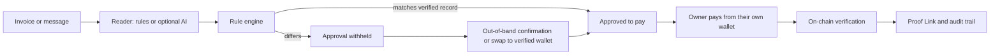

# IntentLock

**Verify the payment instruction before the money moves.**

IntentLock is a payment-instruction firewall for stablecoin payments. It reads an invoice or message, compares the payment destination with the supplier's verified record, withholds approval when something has changed, and afterwards verifies the USDT payment on-chain and issues a shareable Proof Link.

Built for the Cleva x Tether Future of Payments Hackathon.

## The problem

Payment-redirection fraud works because only one detail changes. An attacker impersonates or compromises a supplier's email or WhatsApp and sends a genuine-looking invoice with a new bank account or USDT wallet. The supplier, goods and amount are all real, so ordinary invoice checks pass. A confirmed stablecoin transfer cannot be reversed, so there is no recall window.

- The FBI's 2025 Internet Crime Report records 24,768 business email compromise complaints and about $3.05 billion in losses in the United States.
- ngCERT, Nigeria's national CERT, publishes guidance on vendor impersonation that directs payments to accounts controlled by the scammer.

The usual defence is a manual callback, which busy teams skip or forget. IntentLock automates that control, enforces it before payment, and keeps the evidence.

## How it works



1. **Read.** The invoice, PDF or pasted message is converted into structured fields: supplier, invoice number, amount, network and destination.
2. **Check.** A deterministic rule engine compares those fields with the supplier's approved wallets, email domain, payment history and optional signed instruction.
3. **Decide.** The result is approved, verify first, or approval withheld, with every reason listed in plain language.
4. **Confirm.** A flagged payment needs an out-of-band confirmation (a callback to a saved number, a second approver, or the supplier's verified channel), or the owner can swap to the supplier's registered wallet.
5. **Verify.** After paying, IntentLock checks the transaction on-chain: genuine Tether contract, network, destination, amount and confirmations.
6. **Prove.** A Proof Link shows what was checked, who confirmed it and what happened on-chain, backed by a hash-chained audit trail.

## Design principles

- **AI reads, rules decide.** An optional LLM extracts fields and explains results. It never approves a payment. Any wallet address or invoice number the AI returns must appear verbatim in the source text, otherwise it is ignored.
- **No custody.** IntentLock holds no funds and no keys. The user pays from their own wallet or Cleva account. IntentLock gives or withholds approval.
- **Evidence by default.** Every check, confirmation and settlement is recorded in a tamper-evident audit trail.
- **Works without AI.** With no API key the app reads invoices with built-in rules.

## Features

- Invoice and message reader (pasted text, PDF, optional image reading with a vision model)
- 20+ deterministic risk rules (see below)
- Supplier registry with approved wallets and known email domains
- Optional supplier-signed payment instructions (EIP-712) with nonce and expiry replay protection
- Side-by-side wallet comparison with differences highlighted and one-click swap to the verified wallet
- Out-of-band confirmation workflow
- On-chain verification of USDT on TRON and Ethereum, including fake-token detection
- Shareable Proof Link with hash-chained audit trail

## Quick start

Requires Python 3.10 or newer. Open the project folder in VS Code and run the following in its terminal.

**Windows (PowerShell)**
```
python -m venv .venv
.venv\Scripts\Activate.ps1
pip install -r requirements.txt
python selftest.py
uvicorn backend.main:app --reload
```
If activation is blocked, run `Set-ExecutionPolicy -Scope Process Bypass` and activate again.

**macOS or Linux**
```
python3 -m venv .venv
source .venv/bin/activate
pip install -r requirements.txt
python selftest.py
uvicorn backend.main:app --reload
```

Open http://127.0.0.1:8000. `python selftest.py` runs offline and should print PASS on every line.

## Configuration

Copy `.env.example` to `.env`. Every setting is optional.

| Variable | Purpose |
| --- | --- |
| `LLM_API_KEY`, `LLM_BASE_URL`, `LLM_MODEL` | Turns on AI reading and explanations. Works with any OpenAI-compatible API, including hosted Llama providers and local Ollama. |
| `LLM_VISION` | Set to `1` if your model accepts images, to allow photographed invoices. |
| `TRONGRID_API_KEY` | Avoids rate limits on TRON lookups. |
| `TRON_API_URL`, `ETH_RPC_URL` | Override the public chain data endpoints. |

Never commit `.env`. It is listed in `.gitignore`.

## Demo walkthrough

1. Click **Load demo supplier**. This creates "Global Trade Ltd" with an approved wallet, a known email domain and a demo signing key.
2. Click **Genuine invoice**, then open **Supplier signature** and click **Sign as supplier (demo)**, then **Run check**. The result is approved to pay.
3. Click **Tampered invoice** and run the check. The wallet is swapped, the sender domain is a lookalike, the message announces a changed wallet, and there is no signature. Approval is withheld.
4. Review the wallet comparison and click **Swap to the verified wallet**.
5. Enter `DEMO-REAL` as the transaction hash and click **Verify payment**. Try `DEMO-FAKE` and `DEMO-WRONG` to see a counterfeit token and a wrong destination caught.
6. Click **Open proof** to see the Proof Link and audit trail.

To show signature checking on its own, sign the genuine invoice, click **Tamper with signature**, and run the check again.

## Live on-chain test

1. Add a supplier with your own Cleva USDT (TRON) deposit address as the approved wallet.
2. Paste an invoice for that address (at least 10 USDT, Cleva's minimum deposit per stablecoin deposit).
3. Send the USDT from another wallet or exchange, wait for confirmations, then paste the real transaction hash and verify.

## Risk rules

| Rule | Severity | Triggers when |
| --- | --- | --- |
| `INVALID_ADDRESS` | Critical | The destination is not a valid TRON or Ethereum address |
| `DESTINATION_CHANGED` | Critical | The destination is not in the supplier's approved list |
| `SIG_INVALID` | Critical | The supplier signature does not match the registered key |
| `SIG_MISMATCH` | Critical | The signed instruction differs from the invoice |
| `SIG_REPLAY` | Critical | A signed instruction was already used for a verified payment |
| `NEW_PAYEE` | High | No verified history exists for the supplier |
| `UNSIGNED_INSTRUCTION` | High | The supplier signs instructions but this invoice has no signature |
| `LOOKALIKE_DOMAIN` | High | The sender domain is within two edits of the known domain |
| `CHANGE_ANNOUNCED` | High | The message announces new payment details |
| `DUPLICATE_INVOICE_CHANGED` | High | An invoice number was reused with a different amount or destination |
| `NETWORK_MISMATCH`, `NO_DESTINATION`, `NO_APPROVED_DESTINATION`, `SIG_EXPIRED` | High | Network and address disagree, nothing to pay to, or an expired signature |
| `URGENCY_PRESSURE`, `AMOUNT_ANOMALY`, `SENDER_DOMAIN_DIFFERS`, `DUPLICATE_PAID`, `CURRENCY` | Medium | Pressure language, an amount over 3x the largest earlier payment, a different sender domain, an already-paid invoice, or an unexpected currency |

Any critical finding withholds approval. Any high or medium finding requires verification. With no findings above informational, the payment is approved.

## API

| Method and path | Purpose |
| --- | --- |
| `GET /api/health` | Service status and whether AI reading is on |
| `GET`, `POST /api/suppliers` | List or add suppliers |
| `POST /api/analyze` | Check an invoice (multipart: text, file, sender, signed instruction) |
| `GET /api/checks`, `GET /api/checks/{id}` | History and a single check |
| `POST /api/checks/{id}/confirm` | Record an out-of-band confirmation |
| `POST /api/checks/{id}/use-verified` | Swap to the supplier's registered wallet |
| `POST /api/checks/{id}/reject` | Reject the invoice |
| `POST /api/checks/{id}/settle` | Verify an on-chain payment |
| `GET /api/proof/{token}` | Public proof record |

## Project structure

```
backend/
  main.py        API routes
  rules.py       deterministic risk rules and decision
  chain.py       address validation and on-chain verification
  signing.py     supplier-signed instructions (EIP-712)
  extract.py     invoice reading (rules, PDF, optional AI)
  llm.py         optional OpenAI-compatible client
  audit.py       hash-chained audit log
  db.py          SQLite layer
  config.py      settings
frontend/
  index.html     main interface
  proof.html     public Proof Link page
selftest.py      offline self-test
```

## Status and limitations

**Working:** address validation, the rule engine, signature verification, the audit chain, TRON and Ethereum transaction verification from public chain data, the interface and the Proof Link.

**Simulated for demonstration:**
- Transaction hashes starting with `DEMO` return labelled simulated results.
- Demo signing keys are generated and held by the server so the flow can be shown. In production, suppliers sign on their own device and the server never sees the key.

**Not built:**
- No Cleva API integration. IntentLock sits in front of any payment rail, and Cleva is the USDT receiving account in the demo.
- IntentLock does not send payments or block a transfer made elsewhere. It gives or withholds approval.
- USD bank-account suppliers cannot yet be registered, only wallets.
- No WhatsApp integration yet; messages are pasted in.

IntentLock is a decision-support and audit tool. It does not guarantee that a payment is safe, and it is not a substitute for verifying payment details with your supplier.

## Roadmap

- WhatsApp assistant for forwarded invoices
- Approval as a co-signing step in the wallet payment flow, so approval can gate the transfer itself
- Supplier-side signing with their own wallet and an enrolment flow
- USD bank-account verification
- Payment-security API for fintechs and marketplaces

## Troubleshooting

- `ModuleNotFoundError`: the virtual environment is not active, or `pip install -r requirements.txt` did not finish.
- Port busy: add `--port 8001` to the uvicorn command.
- TRON lookups fail or rate-limit: add a free `TRONGRID_API_KEY` to `.env`.
- Reset all data by deleting `intentlock.db`.

## Team

[Team name] | [Member names]
